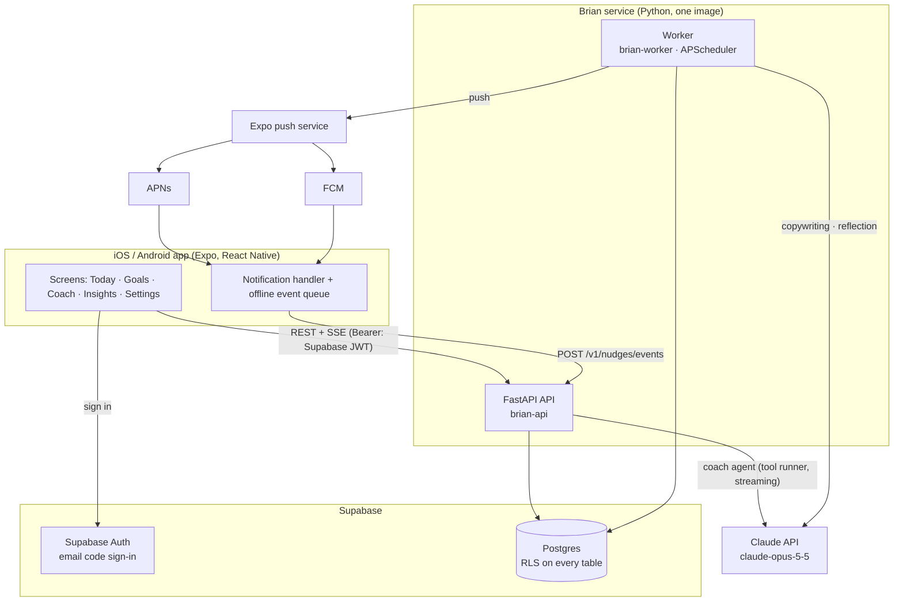
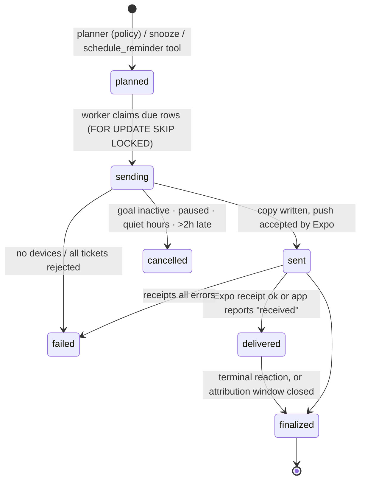
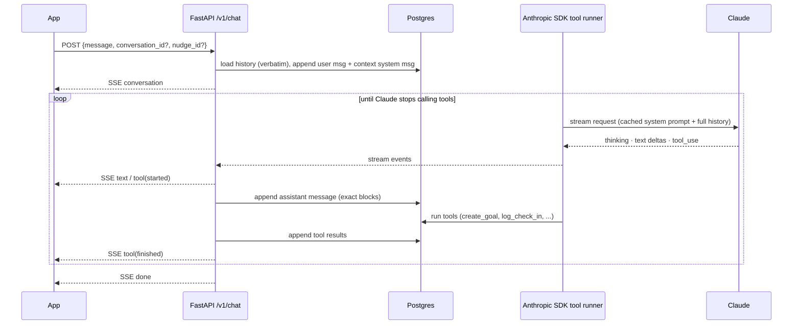

# Architecture

| Piece | Choice | Why |
|---|---|---|
| Mobile | Expo SDK 58 (React Native 0.88, Expo Router, TypeScript) | One codebase for iOS and Android with managed native builds (EAS), OTA updates and first-class push support. |
| Auth + database | Supabase (Auth + Postgres) | Hosted auth with email codes (Apple/Google sign-in are config toggles), Postgres for an analytics-heavy app, local stack via `supabase start`. |
| API + worker | FastAPI, SQLAlchemy 2 (async), APScheduler, Python 3.13 | Python is where the data/ML tooling lives (NumPy now, VW/scikit-learn later). One image, two processes. |
| Agent | Anthropic Python SDK: tool runner, structured outputs, server-side refusal fallbacks | See *Agent design* below. |
| Push | Expo push service | One API for APNs and FCM, receipts, no per-platform certificates in the backend. |
| Contract | OpenAPI generated by FastAPI → `openapi-typescript` | The app's API types are generated from the backend; CI fails on drift. |

## Data model

Defined in `supabase/migrations/` (source of truth) and mirrored by `services/api/src/brian/models.py`
(a test fails if they drift).

* `profiles` (1:1 with `auth.users`, created by trigger): time zone, nudge intensity, quiet hours, pause.
* `goals` → `milestones`, `check_ins`.
* `devices`: Expo push tokens (a token moves to whoever signs in on that phone).
* `nudges`: one row per proactive message: the policy's decision (`arms`), its probabilities
  (`propensities`), the features it saw (`context`), the copy, delivery state and the final
  `outcome`/`reward`.
* `nudge_events`: append-only raw interaction log (idempotent by `client_event_id`).
* `policy_stats`: decayed reward sums per (user or population, dimension, context, arm).
* `conversations` → `chat_messages`: the coach chat, stored as the exact Claude content blocks.
* `memories`: durable facts the coach saved. `insights`: weekly stats + playbook.

Every table has row-level security: signed-in users can *read* their own rows through Supabase's
APIs (useful for Realtime later); all writes go through the Brian API, which connects as the table
owner.

## Nudge lifecycle

`finalized` is `finalized_at` + `outcome` + `reward` on the row; finalizing updates `policy_stats`.
Details of the policy and rewards: [nudge-engine.md](nudge-engine.md).

## Coach chat turn

## Agent design

**Why the SDK tool runner** (rather than the Claude Agent SDK or Managed Agents): the coach needs
an agent loop over *our own* tools against *our* database, inside a multi-tenant API that streams
to phones. The tool runner (`client.beta.messages.tool_runner`) gives the managed loop with typed
tools (`@beta_async_tool` builds schemas from signatures and validates inputs) and per-turn hooks,
with no extra process per request. The Claude Agent SDK is Claude Code as a library (file system,
shell, coding tools), and Managed Agents hosts a sandbox per session; both are better fits for
agents that need a workspace, which a goal coach does not. Either can be added later for
heavier offline analysis.

**Prompt and history discipline.**
* The system prompt (`agent/prompts.py`) is frozen and cached. Per-turn facts (local time, goals
  with ids, playbook, memories, the nudge being replied to) are **appended** each turn as a
  mid-conversation `role: "system"` message, never edited into the system prompt.
* History is stored exactly as sent and received (`chat_messages.content`) and replayed verbatim,
  so the request prefix is append-only. That keeps thinking blocks valid (Claude Opus 5.5 ties
  them to the conversation prefix) and the prompt cache warm. A test asserts byte-identical replay.
* Each conversation is pinned to the model it started on (thinking blocks are model-bound).
* Crash recovery: an unanswered turn is dropped; a tool call without its result gets an error
  result appended.

**Models and effort** (all configurable): `claude-opus-5-5` everywhere, with effort `medium` for
chat, `low` for nudge copy (short, high-volume) and `high` for weekly reflection. Thinking is
adaptive (always on for Opus 5.5); `max_tokens` leaves room for it.

**Safety and robustness.** Every request opts into server-side refusal fallbacks
(`fallbacks: "default"`, beta `server-side-fallback-2026-07-01`); `stop_reason == "refusal"` is
handled before content is used. The copywriter and reflection fall back to templates/heuristics
on any SDK error, so the proactive loop never depends on the LLM being up. The SDK retries
429/5xx. The system prompt points people to professional or emergency help where appropriate.

## Reliability

* Jobs are idempotent and safe to run on several workers at once: due nudges are claimed with
  `FOR UPDATE SKIP LOCKED`, planning takes a per-user advisory lock, finalization locks the row.
* Device events are idempotent (`unique (user_id, client_event_id)`) and queued offline on the
  phone; late events within the window still count (30 min grace before ignoring).
* Push: Expo tickets are stored per device; receipts are checked after 15 minutes;
  `DeviceNotRegistered` disables the token.
* `POST /internal/tick` runs the same jobs for hosts that prefer an external cron.

## Security and privacy

* The API verifies Supabase access tokens (JWKS for asymmetric signing keys, or the legacy HS256
  secret) on every request; every query is scoped to the caller.
* `DELETE /v1/me` deletes all of a user's data and, with the service-role key configured, the
  auth user (App Store / Google Play account-deletion requirement).
* Goal, chat and engagement data is sent to the Claude API to provide the service; say so in the
  privacy policy. Secrets live in environment variables only (`.env` is git-ignored).
