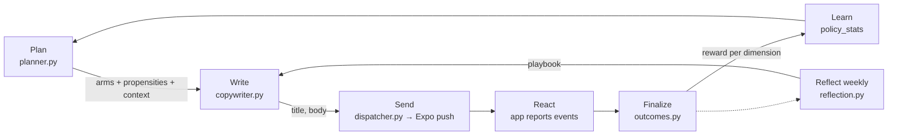

# The nudge engine

Brian's proactive side is a learning loop. Every nudge is an experiment: the engine decides
**when** to reach out and **how** (type, tone, framing, length), Claude writes **the words**, and
the person's reaction becomes data that changes the next decision.



## 1. The decision space

A nudge is one arm from each dimension (`services/api/src/brian/nudges/arms.py`):

| Dimension | Arms |
|---|---|
| `time_window` | early_morning (6-8), morning (8-11), midday (11-14), afternoon (14-17), evening (17-20), night (20-22), all in the user's local time |
| `nudge_type` | reminder, check_in, micro_step, reflection, celebration, streak_save, plan_ahead |
| `tone` | warm, direct, playful, analytical, tough_love |
| `framing` | gain, identity, progress, loss_aversion, curiosity, future_self |
| `length` | short, medium |

Some arms are only eligible in context: `streak_save` and `loss_aversion` need a streak,
`celebration` needs recent progress, `progress` framing needs some history, and time windows are
filtered by quiet hours, the minimum gap between nudges, and windows already used that day.

## 2. The policy: factorized Thompson sampling

`nudges/policy.py`. For each dimension and arm we keep Beta-Bernoulli sufficient statistics
(`policy_stats`): a time-decayed sum of rewards (`successes`) and of `1 - reward` (`failures`).

* **Population prior (empirical Bayes).** A user's posterior for an arm is
  `Beta(κ·μ + s_user, κ·(1-μ) + f_user)` where `μ` is the population's posterior mean for that arm
  and `κ = POLICY_PRIOR_STRENGTH` (default 4) pseudo-observations. New users start from what works
  for everyone; their own evidence takes over after a handful of nudges.
* **Thompson sampling.** Sample once from each eligible arm's posterior and take the best; this
  explores uncertain arms in proportion to their chance of being best.
* **Epsilon floor.** With probability `POLICY_EPSILON` (0.1) an arm is chosen uniformly. This keeps
  every arm's selection probability above `ε/K`, which offline evaluation needs.
* **Propensities.** The probability of each choice under the policy,
  `ε/K + (1-ε)·P(arm wins the Thompson draw)` (Monte Carlo, 2,000 draws), is stored on the nudge
  (`nudges.propensities`) with the features it saw (`nudges.context`).
* **Non-stationarity.** Statistics decay with a half-life (`POLICY_USER_HALF_LIFE_DAYS` = 45,
  `POLICY_GLOBAL_HALF_LIFE_DAYS` = 90), applied lazily on read and update. An arm that hasn't been
  tried for a while drifts back toward the prior and gets re-explored, so the policy follows
  people as their routines change.
* **Context.** Timing is learned separately for weekdays and weekends
  (`context_key = day_type:weekday|weekend`); other dimensions use one slice. Add slices in
  `arms.context_key` (e.g. per goal category) once there is enough traffic.

"Factorized" means each dimension is learned independently from the same reward, so a single
nudge updates five posteriors. It ignores interactions (a playful tone might only work in the
evening); see *Upgrading the model* below.

## 3. Planning

`nudges/planner.py`, every 5 minutes for users with an active goal, a push-enabled device and no
pending nudge:

1. **Budget and fatigue.** `gentle`/`balanced`/`intense` allow 1/2/3 nudges a day. Every 3 ignored
   nudges in a row removes one per day; after 6 the planner backs off for 48 hours.
2. **Which goal.** Sampled with weights favouring goals whose period target isn't met, goals that
   have gone stale, higher priority, and goals not nudged in the last 12 hours.
3. **Which arms.** Thompson sampling per dimension over the eligible arms.
4. **Exact time.** A random 5-minute slot inside the chosen window (outside quiet hours, at least
   `NUDGE_MIN_GAP_MINUTES` after the previous nudge). Planning happens up to ~30h ahead; copy is
   written just before sending so it reflects the latest progress.

A per-user Postgres advisory lock prevents double-planning when several workers run.

## 4. Writing the words

`nudges/copywriter.py` asks Claude (`COPY_MODEL`, effort `low`, structured output) for a title and
body in the chosen style, grounded in: the goal and the person's own *why*, current progress and
streak, their recent check-in notes, remembered facts, the last six notifications with their
outcomes (to avoid repetition), and the **playbook** from reflection. Anything that goes wrong
(no key, outage, refusal) falls back to `templates.py`, so nudges always go out.

## 5. Outcomes and rewards

The app reports raw events (`POST /v1/nudges/events`, idempotent via `client_event_id`):
`received`, `opened`, `action` (done / snooze / reply / not_helpful), `dismissed` (iOS) and
`replied`. Outcomes resolve to the best thing that happened inside the **attribution window**
(`NUDGE_ATTRIBUTION_HOURS`, default 3h after sending):

| Outcome | Reward | Notes |
|---|---|---|
| completed | 1.0 | Tapped "Done", or logged progress on that goal during the window (even without tapping the notification) |
| replied | 0.85 | Wrote back |
| opened | 0.5 | Tapped through, nothing more |
| snoozed | 0.35 (0.1 for `time_window`) | Right message, wrong moment: penalises the timing more than the message |
| dismissed / ignored / negative_feedback | 0 | "Less of these" overrides everything else |

Terminal outcomes (completed, replied, dismissed, negative feedback) finalize immediately; others
wait for the window to close (+30 min grace for offline devices). Finalization is idempotent and
row-locked, updates both the user's and the population's statistics, and only learns from
`source = 'policy'` nudges (a reminder the user asked for says nothing about which arm works).

## 6. Reflection: the qualitative loop

`insights/reflection.py`, daily job, per user at most weekly once 5+ new outcomes exist. Claude
(`REFLECTION_MODEL`, effort `high`) reads the aggregate stats plus the last 30 nudges *with their
wording and outcomes* and writes a playbook: what works, what to avoid, concrete language
guidelines for the copywriter, best times, experiments worth trying, and a plain-language summary
the person sees in the Insights tab. The bandit learns *which* arms work; reflection captures what
the arms can't express ("questions about her kids get replies; anything mentioning weight gets
dismissed").

## 7. Evaluating a new policy offline

Because every decision logs its propensity and context, a candidate policy can be scored on
historical data before it ships. Inverse propensity scoring for "always pick tone X" as an example:

```sql
-- IPS / SNIPS estimate of the reward a fixed-arm policy would have earned
with logged as (
  select reward, (propensities ->> 'tone')::float as p, arms ->> 'tone' as tone
  from nudges
  where source = 'policy' and finalized_at is not null
)
select tone,
       count(*)                                         as matches,
       sum(reward / p) / (select count(*) from logged)  as ips,
       sum(reward / p) / sum(1 / p)                     as snips
from logged
group by tone
order by snips desc;
```

For a stochastic candidate policy, weight each logged nudge by `π_new(arm | context) / p`.

## 8. Upgrading the model

The policy is deliberately simple and transparent. Natural next steps, all compatible with the
logged data:

* **Contextual bandit.** Replace per-dimension Beta posteriors with a model over context features
  and arm features, e.g. [Vowpal Wabbit](https://vowpalwabbit.org/) `--cb_explore_adf` or a
  Bayesian logistic regression with Thompson sampling. Keep logging propensities.
* **Interactions.** Learn joint arms for the pairs that matter (tone × time_window).
* **Minute-level timing.** Learn the offset within a window, or use survival models of
  time-to-response.
* **LLM-proposed candidates.** Generate several candidate messages and let the bandit choose
  between their embeddings.

Metrics worth a dashboard: engagement and completion rate per cohort, exploration rate,
posterior entropy per dimension, ignore streaks, and opt-outs (notification permission revoked).

## 9. Simulation

`services/api/src/brian/sim/` drives synthetic people through the production code paths (planner,
policy, dispatcher, event ingestion, check-in attribution, finalization) on a simulated clock.
Each persona has hidden preferences: log-odds shifts per arm that set how likely they are to
engage, plus how they engage (do it, reply, snooze, open) and how often they log progress on their
own. Only pushes (recorded in memory) and copy (templates, or Claude with `--llm`) are swapped out.

```bash
cd services/api
uv run brian-dev simulate --days 28            # all personas, learning vs random policy
uv run brian-dev simulate --personas sam --days 56 --no-baseline
```

Synthetic accounts are deleted and the population statistics restored afterwards, so a run never
shapes real users' priors. `brian-dev seed --email ...` uses the same machinery to give a real
account weeks of history for demos and UI work.

The report has two parts:

* **Decision quality per week**: the mean *true* engagement probability of the arms the policy
  picked. It is free of reaction noise, so it is the learning curve. "Engaged" also counts goals
  logged in the attribution window without touching the notification, so it runs higher.
* **Learned vs hidden truth** per dimension: the policy's top arms (posterior means) next to the
  persona's true top two.

A 28-day run (3 personas, about 45-50 policy nudges each):

| Person | Policy | Engaged | Week 1 | Week 2 | Week 3 | Week 4 |
|---|---|---|---|---|---|---|
| Maya | learning | 77% | 58% | 59% | 60% | 64% |
| Maya | random | 54% | 48% | 36% | 52% | 57% |
| Sam | learning | 71% | 40% | 62% | 57% | 79% |
| Sam | random | 36% | 38% | 42% | 29% | 36% |
| Jordan | learning | 62% | 56% | 62% | 67% | 72% |
| Jordan | random | 31% | 38% | 29% | 30% | 33% |

The learning policy's top arm matched the persona's true top two in 13 of 15 dimension checks.
The misses were Maya's tone and framing, where a month of about 45 nudges spread over five tones
and six framings is not enough evidence. That is the motivation for the population prior and for
sharing evidence across similar users once there is real traffic. `tests/test_simulation.py`
asserts that the learning policy beats random and finds the right time window.
